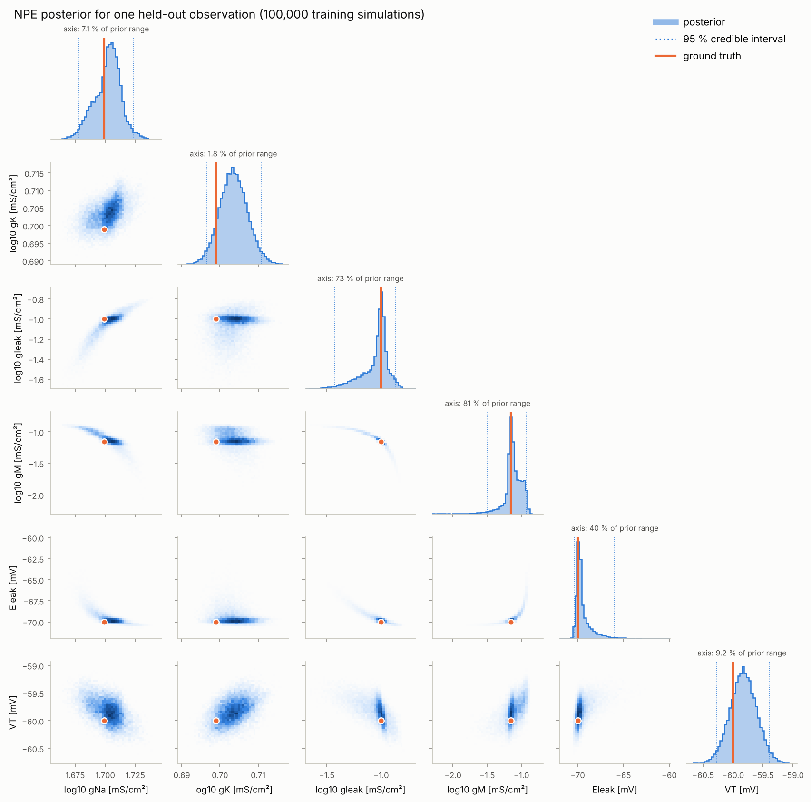

# neuro-sbi

Simulation-based inference for a mechanistic neuron model: **amortized neural
posterior estimation (NPE)** with normalizing flows on a single-compartment
**Hodgkin–Huxley** neuron, validated with **simulation-based calibration
(SBC)**, expected-coverage tests, parameter recovery and posterior predictive
checks.

Given the voltage response of a neuron to a current step, neuro-sbi returns
the full posterior distribution over its conductances and related constants
(gNa, gK, gleak, gM, Eleak, VT) — not a single best fit — and shows that this
posterior is calibrated. Everything runs offline on a CPU: no external data,
no API keys.



## What is in the box

| stage | implementation |
|---|---|
| simulator | Hodgkin–Huxley neuron (Pospischil et al. 2008) with Na⁺, K⁺, slow M-type K⁺ and leak currents, membrane noise and a step current; vectorized exponential-Euler integrator verified against `scipy.integrate.solve_ivp` (LSODA) |
| summary statistics | 12 standard electrophysiological features: spike count, resting potential mean/SD, stimulus-period mean/SD, first-spike latency, firing rate, AP threshold, amplitude, width, AHP depth, adaptation index |
| prior | log-uniform on conductances, uniform on voltages |
| inference | amortized NPE with the [`sbi`](https://github.com/sbi-dev/sbi) toolkit and PyTorch: an ensemble of 5 neural spline flows, whose mixture corrects the over-confidence of a single flow; train once, infer on any number of new recordings |
| validation | SBC rank histograms + ECDF bands, KS/χ² uniformity tests, marginal and joint-HPD expected coverage, recovery of a known ground truth, amortized recovery statistics on 1000 held-out cells, posterior predictive checks |

The method, the model and how to read every diagnostic are explained for
neuroscientists in **[docs/SCIENCE.md](docs/SCIENCE.md)**; the numbers of the
committed run are in **[docs/RESULTS.md](docs/RESULTS.md)**.

## Headline results (`full` run, 100k simulations)

* **Worked recovery:** for a held-out recording, all six true parameters lie
  inside their 95 % credible intervals. gNa, gK and VT are recovered to
  within a few per cent.
* **Posterior predictive check:** 98 % of posterior-predictive simulations
  reproduce the observed spike count (prior: 7 %), and every feature falls at
  a central predictive quantile (0.17–0.66).
* **Calibration** (1000 held-out simulations): close to calibrated but
  slightly over-confident. Marginal 95 % intervals cover the truth 91.5–93.7 %
  of the time and the joint 95 % region 89.8 %. Five of six parameters pass
  SBC rank uniformity; Eleak does not. Details and causes are in
  [RESULTS.md §3](docs/RESULTS.md#3-calibration-sbc-and-expected-coverage).
* **Identifiability:** in cells that fire, gNa, gK and VT are pinned down
  (posterior contraction ≥ 0.998). gleak, gM and Eleak trade off along a
  compensation ridge.

## Quick start

```bash
pip install torch --index-url https://download.pytorch.org/whl/cpu   # optional: CPU-only wheel
pip install -e ".[dev]"
```

```bash
neuro-sbi run --config small        # default, ~1 min on 4 cores: whole pipeline, small budget
```

```bash
neuro-sbi run --config full         # the committed run: 100k simulations, ~1.5 h on 4 cores
```

Outputs go to `results/<config>/` (`results/` for `full`): figures in
`figures/`, all numbers in `metrics.json`, a readable `report.md`, the
per-simulation SBC ranks and HPD levels in `sbc.npz`, and the trained posterior
`posterior.pt`. Most of the `full` time is network training (about 88 min);
simulating the 100k training cells takes about 1.5 min.

Amortized inference with the committed posterior — one simulation, no
retraining:

```bash
neuro-sbi infer --posterior results/posterior.pt --set g_Na=30 --set V_T=-55
```

From Python:

```python
import torch
from neuro_sbi.inference import load_posterior

loaded = load_posterior("results/posterior.pt")
x_o = torch.tensor([...])  # 12 features, order: neuro_sbi.features.FEATURE_NAMES
samples = loaded.posterior.sample((10_000,), x=x_o)  # log10 conductances, mV
```

## Configurations

| config | simulations | estimator (flows × size) | SBC | purpose |
|---|---|---|---|---|
| `tiny` | 300 | 2 × MAF, 2 × 16 | 30 × 50 | unit tests (seconds) |
| `small` | 4,000 | 3 × MAF, 3 × 50 | 200 × 200 | default and CI smoke run of every stage |
| `full` | 100,000 | 5 × NSF, 5 × 64 | 1000 × 1000 | the committed results |

The `small` budget is deliberately too small for publication-quality
posteriors; its purpose is to exercise every stage end-to-end. Use `full` for
conclusions. All randomness is seeded per stage (`--seed`), training sets are
cached in `.cache/`, and `--reuse-posterior` re-runs the validation stages
without retraining.

## Repository layout

```
src/neuro_sbi/
  simulator.py    Hodgkin-Huxley model, exponential-Euler + scipy reference integrators
  features.py     summary statistics
  params.py       parameters, prior, log-space transforms
  batch.py        reproducible, parallel batch simulation
  inference.py    NPE training, saving/loading, sampling (sbi + PyTorch)
  diagnostics.py  SBC, coverage, recovery and predictive-check statistics
  plotting.py     figures
  pipeline.py     end-to-end pipeline;  cli.py  command-line interface
tests/            offline pytest suite (tiny simulator)
results/          committed full run: figures/, metrics.json, report.md, sbc.npz, posterior.pt
docs/             SCIENCE.md (method), RESULTS.md (results)
```

## Quality

* `pytest` — 42 offline tests, ~30 s:
  * integrator vs. scipy reference; resting state as an exact fixed point
  * feature extraction on traces with analytically known features
  * diagnostics on a conjugate-Gaussian model with an exact posterior
    (calibrated, over-, under-confident and biased cases)
  * ensemble mixture density and sampling against analytic Gaussians, and
    rejection sampling against the exact truncated normal
  * trained flows bit-identical whether trained in sequence or in parallel
  * posterior save/load round trip, and the full pipeline on the `tiny` config
* `mypy --strict` and `ruff` clean.
* GitHub Actions: lint, types and tests on Python 3.11 and 3.13, plus an
  end-to-end run of the `small` configuration whose report is posted as the
  job summary and whose outputs are uploaded as an artifact.

## References

Key references (full list in [docs/SCIENCE.md](docs/SCIENCE.md)):

* Gonçalves PJ, Lueckmann J-M, Deistler M, et al. (2020). Training deep neural
  density estimators to identify mechanistic models of neural dynamics.
  *eLife* 9:e56261.
* Cranmer K, Brehmer J, Louppe G (2020). The frontier of simulation-based
  inference. *PNAS* 117(48):30055–30062.
* Papamakarios G, Murray I (2016). Fast ε-free inference of simulation models
  with Bayesian conditional density estimation. *NeurIPS* 29.
* Talts S, Betancourt M, Simpson D, Vehtari A, Gelman A (2018). Validating
  Bayesian inference algorithms with simulation-based calibration.
  arXiv:1804.06788.
* Tejero-Cantero A, Boelts J, Deistler M, et al. (2020). sbi: A toolkit for
  simulation-based inference. *JOSS* 5(52):2505.

## License

MIT © 2026 Cesar Daniel Reinoso. See [LICENSE](LICENSE).
