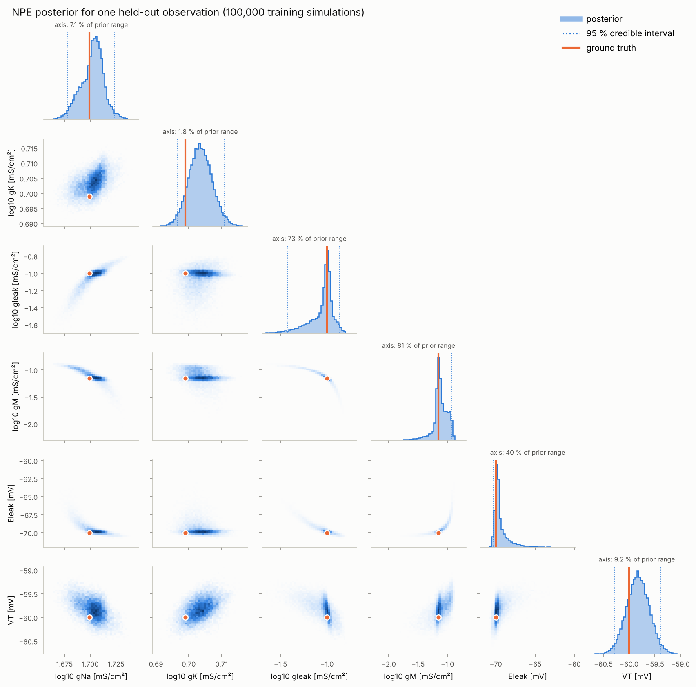
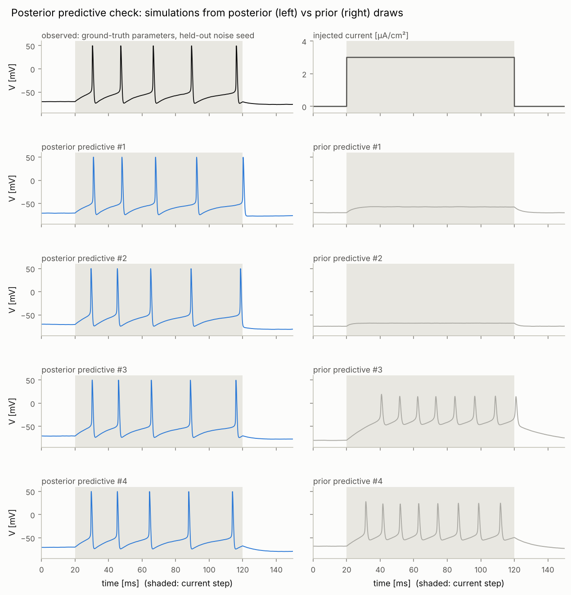
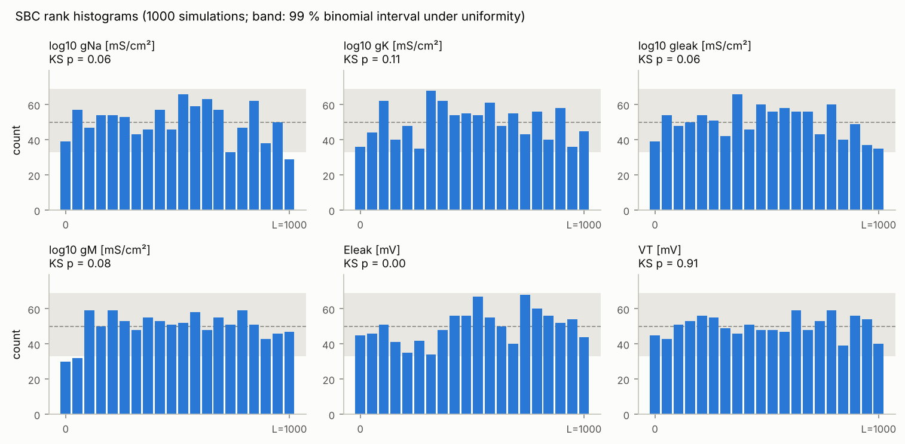
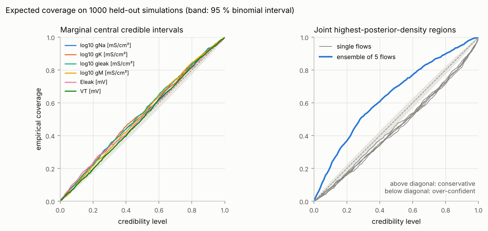
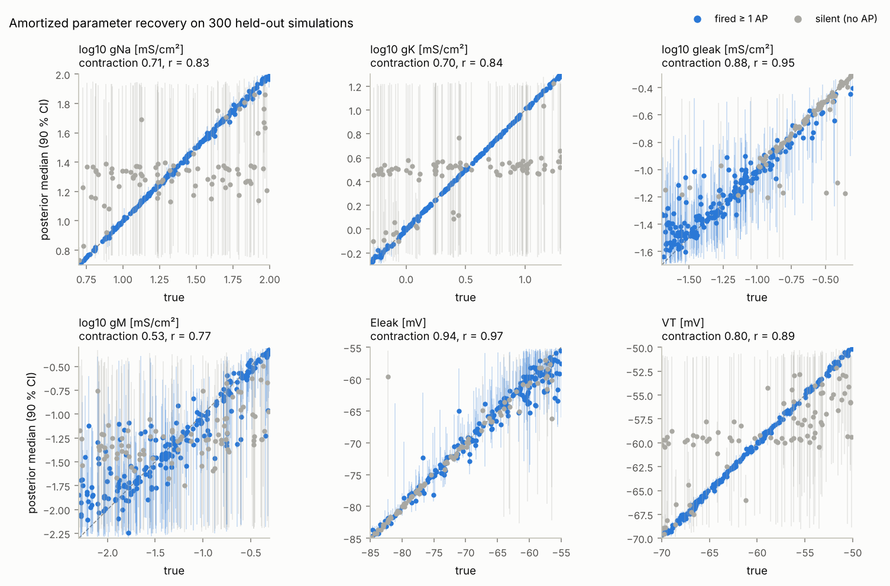

# Results of the `full` run

All numbers below come from the committed run (`neuro-sbi run --config full`).
Its outputs are in [`results/`](../results):

* [`report.md`](../results/report.md): auto-generated tables
* [`metrics.json`](../results/metrics.json): every number
* [`sbc.npz`](../results/sbc.npz): per-simulation SBC ranks and HPD levels, for the ensemble and for each of its flows
* [`posterior.pt`](../results/posterior.pt): the trained posterior

The method and how to read each diagnostic are explained in [SCIENCE.md](SCIENCE.md).

| | |
|---|---|
| training data | 100,000 simulations from the prior; 65.8 % fire at least one AP |
| estimator | equal-weight ensemble of 5 neural spline flows that differ only in their random seed; each has 5 transforms × 64 hidden units (125,126 weights; 625,630 in total) |
| training | each flow in three learning-rate phases (5·10⁻⁴ → 10⁻⁴ → 2·10⁻⁵), 499–633 epochs; best held-out log q(θ \| x) per flow: 7.41, 8.86, 9.09, 7.49, 7.75 |
| wall clock (4 CPU cores) | simulation 82 s; training 86 min (the five flows in parallel, one thread each); all validation stages 5.3 min |
| validation data | 1000 new prior simulations (SBC, coverage, recovery) plus one held-out recording (worked example), never used in training |

**Summary.** A single flow was over-confident: its joint 95 % region held the
truth in 90.9 % of test cases, and 50 % regions held it in 46 %. The ensemble
removes this. Its marginal 95 % intervals cover the truth 94.8–96.2 % of the
time, which is calibrated within sampling error. Its joint regions overshoot
the other way and are conservative: the 95 % region holds the truth in 98.2 %
of cases and the 50 % region in 69.6 %. Its posterior means are also better
point estimates than those of the single flow. Details are in
[§3](#3-calibration-sbc-and-expected-coverage) and
[§4](#4-ensemble-vs-its-individual-flows).

## 1. Worked recovery: the ground truth lies inside the posterior

The observation is the reference cell (gNa = 50, gK = 5, gleak = 0.1,
gM = 0.07 mS/cm², Eleak = −70 mV, VT = −60 mV) simulated with a noise seed that
was never used in training.

| parameter | truth | posterior median | 95 % credible interval | inside |
|---|---|---|---|---|
| gNa [mS/cm²] | 50 | 50.47 | [47.63, 52.86] | yes |
| gK [mS/cm²] | 5 | 5.05 | [4.97, 5.14] | yes |
| gleak [mS/cm²] | 0.1 | 0.096 | [0.037, 0.134] | yes |
| gM [mS/cm²] | 0.07 | 0.074 | [0.031, 0.119] | yes |
| Eleak [mV] | −70 | −69.74 | [−70.35, −66.05] | yes |
| VT [mV] | −60 | −59.83 | [−60.28, −59.39] | yes |

All six true values lie inside their 95 % intervals. The full parameter vector
lies inside the 19.9 % highest-posterior-density region, so it sits close to the
posterior mode.

The spike-generating parameters are pinned down. The 95 % interval is about
±5 % for gNa, ±2 % for gK and ±0.5 mV for VT.

gleak, gM and Eleak are each only loosely determined. They spread along one
curved ridge: less leak is compensated by more M-current and a more
depolarised leak reversal. The recording fixes this combination rather than
the individual values, which is the compensation discussed in
[SCIENCE.md §6](SCIENCE.md#6-reading-the-posterior).

The gM marginal shows how the mixture behaves where its flows disagree. It
has a sharp peak at the true value and a shoulder near log10 gM = −1.0.
Sampled one at a time:

* **Flows 2 and 3**, the two best-trained, put gM at the truth with narrow
  90 % intervals: [−1.19, −1.06] and [−1.20, −1.11] (truth −1.155).
* **The other three** peak near −1.0 and are three to four times wider.

The ensemble keeps both answers.

## 2. Posterior predictive check: the posterior reproduces the recording

Results from simulating the model at 500 posterior draws:

* **Spike count:** 98 % of the simulations fire exactly the observed 5 APs. With prior draws, 7 % do.
* **All 12 features:** the observed value falls at a central predictive quantile, between 0.19 (resting SD) and 0.63 (AP width). No feature is out of reach of the posterior.

See [`ppc_features.png`](../results/figures/ppc_features.png).

## 3. Calibration: SBC and expected coverage

Calibration is tested on 1000 independent prior simulations with 1000
posterior draws each. With 1000 test cases, sampling error alone moves an
empirical coverage by about ±1.4 points at the 95 % level and ±3 points at the
50 % level (95 % binomial interval).

| parameter | SBC KS p | uniform (Bonferroni) | 50 % interval | 90 % interval | 95 % interval |
|---|---|---|---|---|---|
| log10 gNa | 0.056 | yes | 0.524 | 0.933 | 0.962 |
| log10 gK | 0.108 | yes | 0.537 | 0.919 | 0.959 |
| log10 gleak | 0.065 | yes | 0.535 | 0.926 | 0.959 |
| log10 gM | 0.077 | yes | 0.525 | 0.924 | 0.961 |
| Eleak | < 0.001 | **no** | 0.516 | 0.911 | 0.948 |
| VT | 0.915 | yes | 0.505 | 0.915 | 0.951 |

The interval columns give the empirical coverage of central credible intervals.
A calibrated posterior gives 0.50, 0.90 and 0.95.

Joint highest-posterior-density regions with nominal levels 50 / 80 / 90 / 95 %
contain the truth in 69.6 / 89.8 / 95.2 / 98.2 % of cases (blue curve in the
right panel; grey curves are the five flows on their own).

**Verdict: no longer over-confident. Calibrated marginally, conservative
jointly.**

* **Marginal intervals** are calibrated at 95 % (0.948–0.962, all within
  sampling error of 0.95). They are slightly conservative at 50–90 %: the
  largest excess is 3.7 points, for gK at 50 %.
* **Joint regions** are clearly conservative: the regions are larger than
  they need to be. Hermans et al. (2022) argue that this is the acceptable
  failure mode for scientific use: a conservative posterior can lead you to
  claim too little, but not too much.
* **The conservativeness is concentrated in spiking cells.** There the
  joint 50 / 95 % regions cover 75.4 / 98.9 %; in silent cells 58.4 / 96.8 %.
  In spiking cells each flow's posterior is very narrow, so small
  disagreements between the flows about where it sits are large compared with
  its width, and the mixture becomes wider than the true posterior. The
  posterior z-scores agree. In spiking cells their SD is 0.78–0.84 for gNa,
  gK, gleak and gM, where a calibrated posterior gives 1. That means the
  posteriors are roughly 20 % too wide. In silent cells the SD is 0.92–1.04.
* **Eleak** fails the rank-uniformity test because of a small location bias,
  not a width error. Its z-score SD is 1.00, which is correct, but its mean is
  −0.08: the posterior sits slightly below the truth. Four of the five flows
  share this bias (mean normalised rank of the truth 0.517–0.534 against 0.5;
  only flow 3 is unbiased at 0.503). An average cannot cancel a bias its
  members share. Its practical effect is small: Eleak's 95 % intervals cover
  the truth 94.8 % of the time.

## 4. Ensemble vs. its individual flows

The pipeline also runs SBC for each flow alone, on the same 1000 simulations.
Flow 1 is exactly the single-flow posterior committed before the ensemble
was added: it has the same seed and the same training data, and its best
validation log-density is identical to all printed digits.

| posterior | held-out log q(θ* \| x) | joint HPD coverage 50 / 80 / 90 / 95 % | marginal 95 % coverage | parameters passing SBC |
|---|---|---|---|---|
| flow 1 (= previous single flow) | 7.52 | 46.4 / 73.7 / 85.5 / 90.7 % | 92.5–94.6 % | 4 of 6 |
| flow 2 | 8.86 | 41.9 / 72.5 / 84.0 / 90.7 % | 93.8–94.3 % | 6 of 6 |
| flow 3 | 8.95 | 43.8 / 72.5 / 83.4 / 90.5 % | 93.6–94.9 % | 6 of 6 |
| flow 4 | 7.37 | 43.7 / 72.2 / 83.9 / 90.7 % | 93.2–94.3 % | 2 of 6 |
| flow 5 | 7.62 | 44.3 / 71.5 / 81.7 / 90.0 % | 92.2–94.3 % | 3 of 6 |
| **ensemble** | **8.80** | **69.6 / 89.8 / 95.2 / 98.2 %** | **94.8–96.2 %** | **5 of 6** |

Held-out log q(θ* | x) is the mean log-density of the true parameters (higher
is better).

* **Every flow on its own is over-confident**, however well it trained. Its
  joint 95 % region covers the truth 90.0–90.7 % of the time and its 50 %
  region 42–46 %. The two best flows are as over-confident as the others,
  although they pass every marginal SBC test. Marginal checks alone would have
  missed this.
* **The flows differ mainly in how long their first training phase ran.**
  Flows 2 and 3 trained at the highest learning rate for 347 and 408 epochs
  before early stopping lowered it. Flows 1, 4 and 5 stopped that phase after
  122–179 epochs. Their final held-out log-densities are 1.1–1.6 nats lower,
  and they fail some marginal SBC tests
  ([`training_curve.png`](../results/figures/training_curve.png)). Final
  quality follows the length of that first phase. This suggests that early
  stopping, with a patience of 20 epochs on a noisy validation curve, is the
  main source of variation between members.
* **Log-density.** The ensemble's held-out log-density is 0.73 nats above the
  average of its flows (8.07) and 1.2–1.4 nats above the three weaker ones.
  It is 0.06–0.16 nats below the two best flows. Those flows are sharper,
  which the log score rewards, even though their regions are too small.
* **The worked example** (§1) shows the same split: the two best flows agree
  on gM, while the three weaker ones are wider and peak elsewhere.

**Correction to the previous results.** The 95 % coverages published for the
single flow before this change were read from a grid of credibility levels
without a 0.95 point, so they are really the 94 % level. Those numbers were
91.5–93.7 % marginal and 89.8 % joint. Recomputed exactly at 95 % from that
run's `sbc.npz`, they are 92.4–95.0 % marginal and 90.9 % joint; the joint coverage at 50 / 80 / 90 % is 46.3 / 73.7
/ 85.7 %. Flow 1 above reproduces these to within the Monte Carlo error of new
posterior draws. Flow 1 fails SBC for gleak, which it passed before. Its KS
p-value was 0.009 and is now 0.007, on either side of the Bonferroni threshold
of 0.0083, so the test result is not stable for this parameter. The pipeline
now computes coverage exactly at every reported level, and a regression test
covers the case. The conclusion for the single flow (slightly over-confident)
is unchanged.

## 5. Amortized recovery: what the data constrain

Posterior contraction is 1 − posterior variance / prior variance: 0 means the
data taught nothing, 1 means the parameter is pinned down. The figure plots
300 of the 1000 held-out cells.

| parameter | contraction (all) | spiking cells (659) | silent cells (341) | r(posterior mean, truth) | r, previous single flow |
|---|---|---|---|---|---|
| log10 gNa | 0.708 | 0.999 | 0.146 | 0.835 | 0.833 |
| log10 gK | 0.702 | 0.999 | 0.126 | 0.836 | 0.833 |
| log10 gleak | 0.881 | 0.873 | 0.895 | 0.950 | 0.920 |
| log10 gM | 0.529 | 0.741 | 0.119 | 0.766 | 0.679 |
| Eleak | 0.939 | 0.949 | 0.920 | 0.968 | 0.960 |
| VT | 0.795 | 0.998 | 0.403 | 0.892 | 0.891 |

In cells that fire, gNa, gK and VT are essentially identified (contraction
≥ 0.998). The overall averages for these parameters are modest only because a
third of prior draws produce no AP.

A silent response still constrains gleak and Eleak through the resting and
subthreshold voltage. It says little about the spike-generating parameters, and
for those the posterior correctly falls back towards the prior instead of
inventing a confident answer: 95 % coverage in silent cells is 0.935–0.965 for
every parameter.

gM is the hardest parameter. It acts slowly and trades off against leak (see
§1). It is also where the ensemble helps the point estimate most. The
correlation between posterior mean and truth rises from 0.68 to 0.77, and for
gleak from 0.92 to 0.95. The ensemble average is closer to the truth than a
single flow's estimate.

## 6. Training history

* **First run:** a single learning rate. Early stopping fired at epoch
  122 while the validation curve was still rising, and the posterior was
  conservative.
* **Previous committed run:** resumed at two lower learning rates. Held-out
  log q(θ | x) rose by 1.6 nats, to 7.41, and the posterior became slightly
  over-confident.
* **This run:** five such flows in a mixture. The joint calibration
  error changes sign, from over-confident to conservative.

The flow-to-flow spread in §4 suggests the next improvement: make the
first learning-rate phase less sensitive to noise, with a longer patience or
a fixed minimum length. That would bring every member up to the quality of
flows 2 and 3. It would probably also reduce how much they disagree, and so
how conservative the mixture is. This has not been tested.
